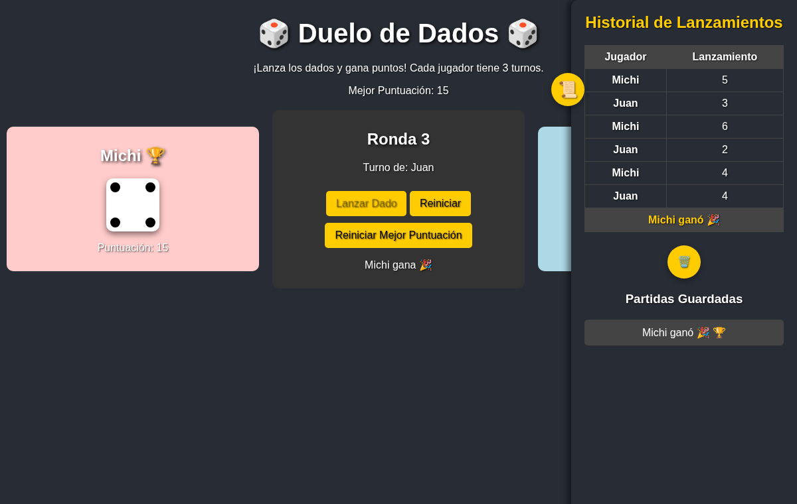
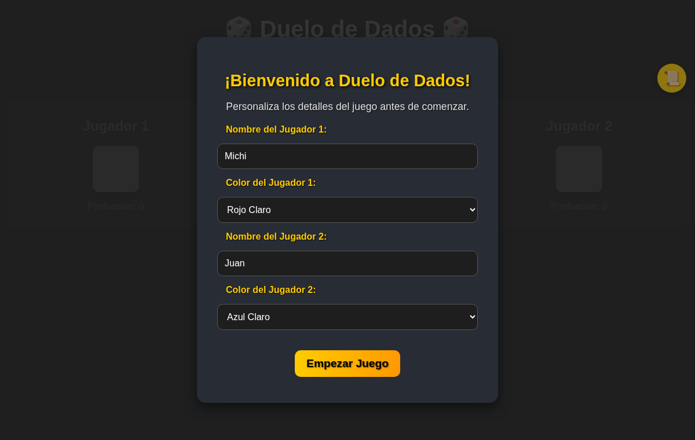
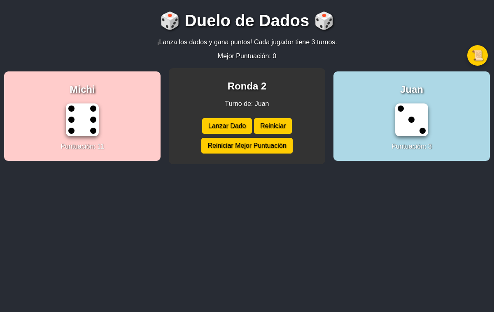

# js-duelo-de-dados

[](https://github.com/Whiteherobot/js-duelo-de-dados/actions/workflows/ci.yml)

Juego de dados para dos jugadores en el navegador: cada uno tira tres veces y
gana quien suma más. Práctica 2 de desarrollo web (marzo de 2025), hecha en
pareja con HTML, CSS y JavaScript, sin librerías.

**Jugar:** https://whiteherobot.github.io/js-duelo-de-dados/



| Inicio | Partida |
|---|---|
|  |  |

- Antes de empezar se eligen los nombres y el color de cada jugador.
- Se tira con el botón o con la barra espaciadora; el dado tiene una animación
  y un sonido de rebote.
- El historial guarda cada lanzamiento y las partidas anteriores, que se pueden
  volver a ver al terminar. La mejor puntuación queda guardada y su dueño lleva
  un trofeo.
- Todo se guarda en el `localStorage` del navegador.

## Pruebas

```bash
npm install
npm test
```

Las pruebas cargan `index.html` y `script.js` en jsdom, fijan los valores del
dado y juegan partidas completas: tres rondas, ganador y empate, récord, nombres
con HTML (se muestran como texto) y reinicios con jugadores nuevos.

## De dónde sale

El juego de 2025 funcionaba, pero tenía algunos errores que se corrigieron en
2026: la última ronda se mostraba como "Ronda 4", los nombres se insertaban con
`innerHTML` (un nombre con HTML se ejecutaba), todas las partidas guardadas
llevaban el trofeo, la mejor puntuación no se actualizaba en pantalla y cada
reinicio con jugadores nuevos agregaba otro listener al botón de inicio. El
sonido y el ícono, que no tenían licencia identificable, se reemplazaron por un
sonido sintetizado con Web Audio y un SVG propio. El repo se llamaba
`duelo-dados_Lata_Alvarez`.

## Autores

- Michael Lata ([@Whiteherobot](https://github.com/Whiteherobot))
- Alvarez ([@Juanfernando518](https://github.com/Juanfernando518))

Licencia MIT.
